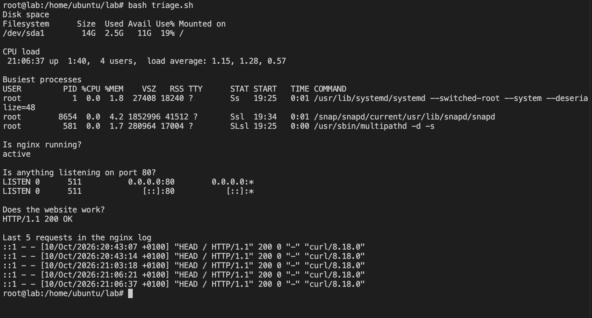

# Runbook 1: Runaway CPU

## What I saw
The server felt slow. triage.sh showed the load average at 1.37 and climbing. This machine only has 1 CPU core, so anything over 1 means it's overloaded. The website still loaded, just slowly.

## What I checked
I ran `ps aux --sort=-%cpu | head -6` to see what was using the CPU. Four `yes` processes were each taking about 25%, so between them they were using the whole core.

## How I fixed it
I stopped them all with `pkill yes`. After that, the busiest processes were back to 0%, and the load dropped below 1 within a few minutes.

## How to stop it happening again
Set up an alert for when the load stays above the number of CPU cores, and find out why a process is using that much CPU before just restarting it.

## Screenshots

