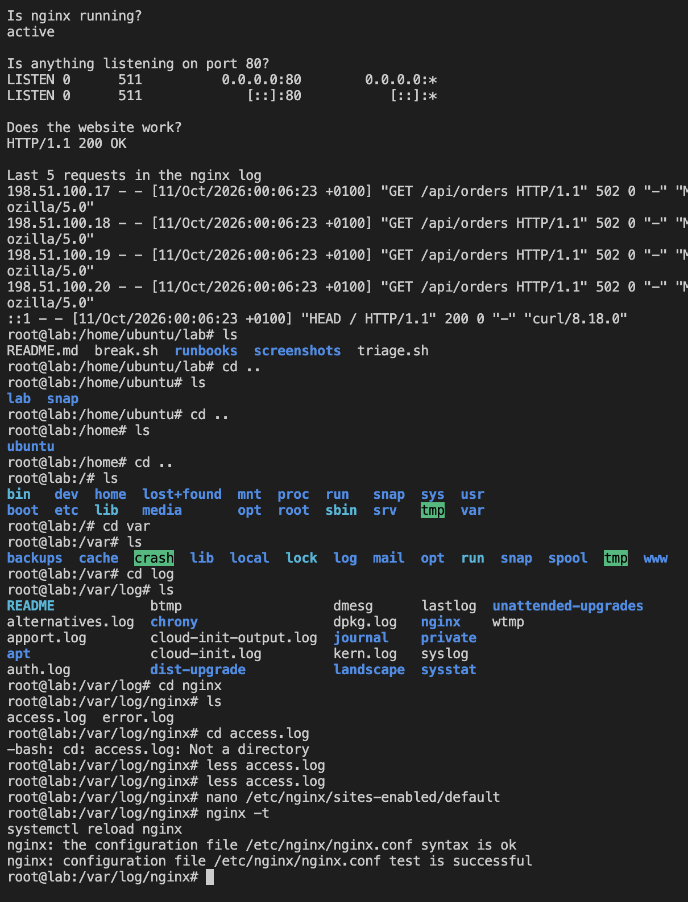

## What I saw
triage.sh looked healthy apart from the log. The last few lines showed 502 errors on /api/orders from IPs I didn't recognise.

## What I checked
I opened the full log with `less /var/log/nginx/access.log` and found two separate problems:

1. **A bot attack.** One IP, 203.0.113.45, sent 200 requests in the same second, all `POST /wp-login.php` from a Python script. It was trying to log in to WordPress. It got 404s because this isn't a WordPress site.
2. **An outage.** 20 different users got 502 errors on /api/orders. A 502 means nginx couldn't get a response from the app behind it.

## How I fixed it
I blocked the attacker by adding `deny 203.0.113.45;` to the nginx config, checked it with `nginx -t`, then ran `systemctl reload nginx`. Any request from that IP now gets a 403.

The 502s need the app behind /api/orders checking. In this lab there's no app, so I've noted it as a separate outage.

## How to stop it happening again
Use rate limiting so one IP can't send hundreds of requests a second, and set up an alert for a sudden rise in 4xx or 5xx errors.

## Screenshot
