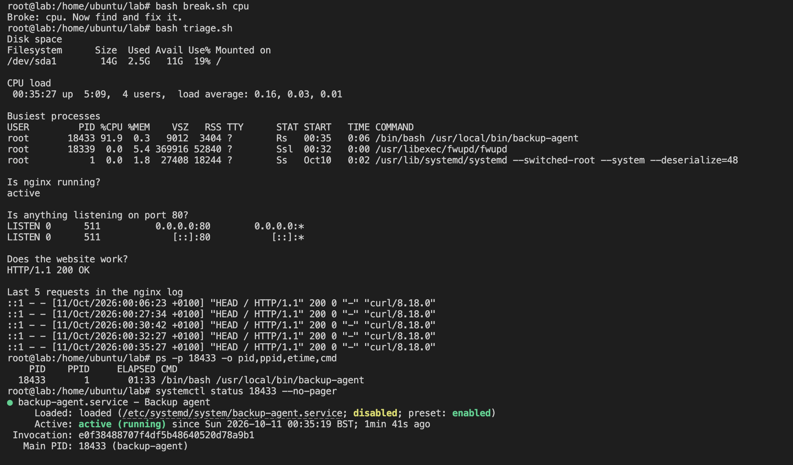

## What I saw
triage.sh showed a process called `backup-agent` (PID 18433) using about 92% CPU, and the load average started climbing. A backup program shouldn't be using almost all the CPU nonstop.

## What I checked
I didn't kill it straight away. First I checked what it was:

- `ps -p 18433 -o pid,ppid,etime,cmd` showed its parent PID was 1, which means systemd started it, not a person
- `systemctl status 18433` show ed it belonged to `backup-agent.service`, and had only been running since 00:35:19, the same time the CPU problem started

Because it was a service, killing the process wouldn't be enough. systemd can restart a service as soon as it stops, so it would just come back with a new PID.

## How I fixed it
I stopped it through systemd instead of using kill:

- `systemctl stop backup-agent`
- `systemctl disable backup-agent` so it can't start at boot

triage.sh then showed `backup-agent` gone, and the load dropped from about 1 back down towards 0.

## How to stop it happening again
Check new services before they're installed, alert when CPU stays high, and always find out what a process is before killing it.

## Screenshot
