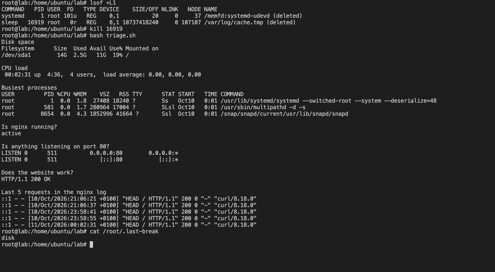

## What I saw
triage.sh showed the disk at 93%, with 13G used out of 14G. The website still worked, but a disk that full can stop logs being written and crash services.

## What I checked
I ran `du -sh /*` to find what was using the space. The folders only added up to about 2.7G (/usr 2.1G, /var 398M, the rest tiny), but df said 13G was used. About 10G was missing and wasn't in any folder.

That pointed to a file that had been deleted but was still held open by a program. Linux doesn't free the space until the program lets go of the file, so du can't see it but df still counts it.

I ran `lsof +L1` to list deleted files that are still open. It showed a `sleep` process (PID 16919) holding `/var/log/cache.tmp (deleted)`, which was 10737418240 bytes, exactly 10G.

## How I fixed it
I stopped the process with `kill 16919`. Running `lsof +L1` again showed the file was gone, and triage.sh showed the disk back to 19%.

## How to stop it happening again
Restart or reload an app after deleting its log files, so it lets go of them. Better still, use logrotate to manage logs instead of deleting them by hand. Also alert at 80% disk usage.

## Screenshot
